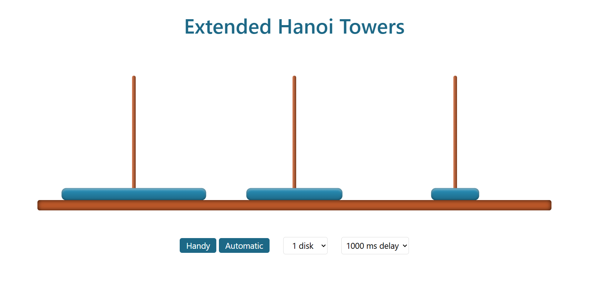

<div align="center">

# Extended Tower of Hanoi

### A Recursive Puzzle Visualizer with Distributed Starting Disks

**A variation of the classic Tower of Hanoi where disks start across all three rods and must be assembled onto a single rod.**

[](https://developer.mozilla.org/en-US/docs/Web/HTML)
[](https://developer.mozilla.org/en-US/docs/Web/CSS)
[](https://developer.mozilla.org/en-US/docs/Web/JavaScript)
[](https://jquery.com/)

</div>

## Preview



## Overview

**Extended Tower of Hanoi** explores a variation of the well-known recursive puzzle. Unlike the classic version, in which every disk begins on the same rod, this version **starts with disks distributed across all three rods**. The goal is still to gather them into a single, correctly ordered stack, following the standard Hanoi movement rules.

The project implements a recursive solution and visualizes the generated moves with animated disks. You can watch the solution run automatically or advance through it step by step.

## What Makes It Different?

| Classic Tower of Hanoi | Extended Tower of Hanoi |
| --- | --- |
| All disks initially occupy one rod. | Disks initially occupy all three rods. |
| The solver transfers one complete stack. | The solver assembles a distributed arrangement into one stack. |
| The conventional solution uses a recursive transfer routine. | This implementation combines a custom `exHanoi` routine with the classic `Hanoi` routine. |

In this implementation, selecting a level of `n` creates **3n disks**: `n` disks on each rod. Their initial sizes are distributed in groups of three across the rods. The target is the third rod.

## Features

- **Distributed starting configuration:** Each of the three rods initially holds disks.
- **Recursive solver:** Generates moves using the `exHanoi` and `Hanoi` functions.
- **Two playback modes:** Choose **Automatic** or **Handy** (step-by-step playback).
- **Step navigation:** Move forward or backward through the solution in Handy mode, or play the remaining moves.
- **Animated visualization:** Follow disk movements across the rods.
- **Configurable size:** Choose from 1 to 10 levels (3 to 30 total disks).
- **Adjustable delay:** Select the animation timing.
- **No build tools required:** Run directly in a web browser.

## How the Algorithm Works

The puzzle follows the usual Tower of Hanoi rules:

1. Move only one disk at a time.
2. Move only the top disk from a rod.
3. Never place a larger disk on a smaller one.

The implementation contains two recursive functions:

- `Hanoi(numberDisks, origin, helper, target)` generates the standard Tower of Hanoi move sequence.
- `exHanoi(numberDisks, origin, helper, target)` recursively resolves the distributed starting configuration and reuses the standard solver for the intermediate transfers.

The generated sequence is then animated using asynchronous JavaScript and CSS transitions. Unlike the classic `2^n - 1` formula, **the move count for this extended starting configuration must be evaluated for its own algorithm and number of disks**.

## How to Use

1. Select the number of levels from the disk selector.
2. Choose an animation delay.
3. Select a playback mode:
   - **Automatic:** Click **Start** to play the solution; use **Pause** to pause after a move and **Start** to resume.
   - **Handy:** Use **Next** to advance, **Last** to go back, and **All** to play the remaining moves after stepping forward.

> **Note:** “Handy” means guided, step-by-step playback of the algorithm's solution—not free dragging and dropping of disks.

## Getting Started

Clone the repository:

```bash
git clone https://github.com/AlirezaMP2003/Extended-Hanoi.git
cd Extended-Hanoi
```

Open `index.html` in a browser.

> The application loads jQuery from a CDN, so it needs an internet connection unless that dependency is already cached.

## Project Structure

```text
Extended-Hanoi/
├── assets/
│   └── extended-hanoi-preview.png  # Screenshot shown above
├── index.html                      # Interface and playback controls
├── ExHanoi.css                     # Layout and disk animations
├── ExHanoi.js                      # Recursive algorithms and playback logic
└── README.md                       # Project documentation
```

## Concepts Explored

- Recursive algorithms and decomposition of complex problems
- Applying a classic algorithm to a different initial state
- Representing puzzle states and generating move sequences
- Asynchronous animations with `async` / `await` and Promises
- DOM manipulation and interactive playback controls

## Related Project

See the original [Tower of Hanoi visualizer](https://github.com/AlirezaMP2003/Hanoi) for the classic starting configuration.

## Author

**Alireza Mousapour** · [GitHub @AlirezaMP2003](https://github.com/AlirezaMP2003)
